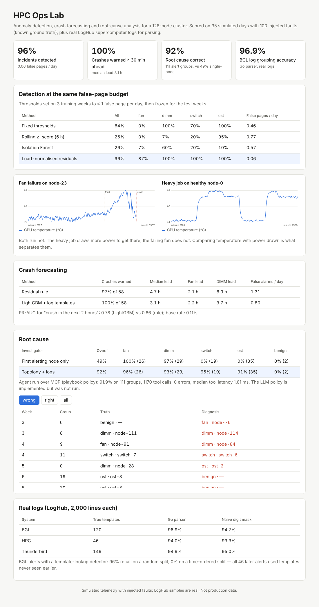

# HPC Ops Lab — Anomaly Detection, Crash Forecasting & Root-Cause Analysis for a Supercomputer

AI-driven operations for a 128-node cluster: a **Go log-ingest service** (Drain template miner + HTTP API
with Prometheus metrics), **anomaly detection**, **node-crash forecasting**, a **root-cause agent served
over MCP**, and a **React dashboard**. Every method is scored against ground truth.

**What is real and what is simulated**
- **Real:** LogHub supercomputer log samples (BGL — IBM Blue Gene/L, HPC — Los Alamos, Thunderbird — Sandia),
  2,000 lines each with hand-labelled templates; used for parsing accuracy and a BGL alert study.
- **Simulated:** cluster telemetry (power, temperature, ECC errors, network retransmits, I/O wait) and node
  logs with **injected faults whose type, component and timing are known**. That known truth is what makes
  detection delay, forecast lead time and root-cause accuracy measurable. Not production data.
- The root-cause agent's published numbers use a **deterministic playbook policy** over the MCP tools. An
  LLM policy (Anthropic tool use) is implemented in `hpcops/agent.py` but **was not run** (no API key).



## Results

### Real logs (LogHub, 2,000 lines each)
| System | True templates | Go parser grouping accuracy | Naive "mask digits" baseline |
|---|---|---|---|
| BGL | 120 | **96.9%** | 94.7% |
| HPC | 46 | **94.0%** | 93.3% |
| Thunderbird | 149 | 94.9% | **95.0%** |

The format extractor reproduced LogHub's message field on 100% of lines. On these small samples a naive
mask nearly matches Drain (and beats it on Thunderbird), which is reported as is.

**BGL alert detection — split matters.** A detector that looks up whether a template was mostly alerts:
- random 60/40 split: 99% precision, 96% recall (mean of 20 splits)
- **time-ordered split: 0% recall** — all 46 alerts in the later 40% used templates never seen earlier
- a severity rule (`FATAL`) on the same time split: 100% recall at 36% precision; `FATAL` and a new
  template: 100% recall at 50% precision

A random split leaks future templates into training; only the time-ordered result says how a deployed
detector would do. 46 alerts is a small sample.

### Simulated cluster (3 training weeks, 5 test weeks, 100 injected faults)
Faults: fan failure (temperature climbs without extra power → throttle → crash), failing memory
(DIMM; correctable ECC errors grow for hours → crash), network-switch link flapping (16 nodes), and a slow
storage target (OST; I/O wait on the *busy* nodes among 32 striped across all racks). Benign confounder:
heavy jobs that draw ~20% more power and run hot.

**Detection** — every threshold set on the training weeks for ≤ 1 false page/day, then frozen:

| Method | All | Fan | DIMM | Switch | OST | False pages/day (test) |
|---|---|---|---|---|---|---|
| Fixed thresholds (85 °C, …) | 64% | 0% | 100% | 70% | 100% | 0.46 |
| Rolling z-score (6 h) | 25% | 0% | 7% | 20% | 95% | 0.77 |
| Isolation Forest | 26% | 7% | 60% | 20% | 10% | 0.57 |
| **Load-normalised residuals** | **96%** | **87%** | **100%** | **100%** | **100%** | **0.06** |

To stay within the page budget the fixed thresholds had to rise ~8% (temperature to ~92 °C), which missed every fan
failure: heavy jobs are hotter than most failing fans. Comparing temperature with *power drawn* (and I/O
wait and retransmits with utilisation) separates them. Median detection delay with residuals: switch 3
min, OST 2 min, fan 86 min, DIMM 265 min (the DIMM error rate starts near background).

**Crash forecasting** ("crash in the next 2 hours"; a crash counts as warned if an alarm starts 30–720 min before it):

| Method | Crashes warned | Median lead | Fan lead | DIMM lead | False alarms/day |
|---|---|---|---|---|---|
| Residual rule (temperature / ECC z-scores) | 97% of 58 | 4.7 h | 2.1 h | 6.9 h | 1.31 (0.90 in training) |
| **LightGBM + Go log-template counts** | **100% of 58** | 3.1 h | 2.2 h | 3.7 h | **0.80** |

PR-AUC 0.78 vs 0.66 (base rate 0.11%). The model catches every crash with fewer false alarms but warns
**later** on failing memory than the rule (3.7 h vs 6.9 h), because it was trained for a 2-hour horizon —
a trade-off to choose deliberately, not a free win. The rule's false-alarm rate also drifted above its
training budget on the test weeks.

**Root cause** (111 alert groups from the residual detector; correct = right fault type *and* component):

| Investigator | Overall | Fan | DIMM | Switch | OST |
|---|---|---|---|---|---|
| First alerting node only | 49% | 100% | 97% | 0% | 0% |
| **Topology + logs** | **92%** | 96% | 93% | 95% | 91% |

Blaming the first alerting node can never name a switch or a storage target. The topology investigator
counts alerting nodes by switch and storage target, treats a hot node drawing extra power as a heavy job,
and reads the node's Lustre errors (which name the storage target) when too few busy nodes are affected to
triangulate. Both false-alarm groups (2) were misdiagnosed as fan faults.

**Agent over MCP:** the playbook policy, calling 6 tools on the stdio MCP server, reproduced 91.9% (102/111)
with 1,170 tool calls, 0 errors, 1.8 ms median tool latency; every call is traced to `results/agent_trace.jsonl`.
Ground truth is never exposed as a tool (tested).

### Bugs found while building (kept in the history)
- Fan heat kept being applied after a crashed node rebooted, creating hot "faults" with no incident.
- The smoothing filter carried pre-crash values across downtime, so every reboot looked like a spike.
- Merging alert groups "while active" chained unrelated faults into one long group; reverted.

## Layout
```
go/logparse/      Go: Drain template miner, LogHub format extractor, CLI, HTTP ingest service (+ tests)
hpcops/
  realogs.py      LogHub parsing accuracy and BGL alert study (calls the Go binary)
  sim.py          cluster, topology, jobs, injected faults, node logs
  features.py     load-normalised baselines and signals
  detect.py       four detectors, episodes, paging, threshold calibration
  logs.py         simulated logs -> Go parser -> template-count features
  forecast.py     LightGBM crash forecaster vs rule
  rca.py          alert grouping, tools, single-node vs topology investigators
  mcp_server.py   MCP server (stdio) exposing the read-only tools
  agent.py        playbook policy + LLM policy (not run), MCP client, tracing
  study.py        end-to-end study -> results/study.json
dashboard/        React (Vite) dashboard reading dashboard/public/data.json
tests/            pytest suite (simulation, no-future-data check, detection logic, RCA rules, MCP)
```

## Run
```bash
cd go/logparse && go test -race ./... && go build -o ../../bin/logparse . && cd ../..
#   (Windows: go build -o ..\..\bin\logparse.exe .)
pip install -r requirements.txt
python -m hpcops.realogs          # real-log results  -> results/realogs.json
python -m hpcops.study            # simulated study   -> results/study.json (~3 min)
python -m hpcops.agent            # agent over MCP    -> results/agent_playbook.json
python -m hpcops.export_dashboard && cd dashboard && npm install && npm run build
pytest -q
# service:  bin/logparse serve -addr :8080   (POST /ingest, GET /templates, GET /metrics, GET /healthz)
```

### LLM agent (Anthropic API)
Requires `results/work/state.pkl` from `python -m hpcops.study`.
```bash
pip install anthropic
export ANTHROPIC_API_KEY=...            # PowerShell: $env:ANTHROPIC_API_KEY = "..."
python -m hpcops.agent --backend anthropic --limit 10     # small, cheap first run
python -m hpcops.agent --backend anthropic                # all 111 alert groups
# --model <id> (or $HPCOPS_MODEL) picks the model; results -> results/agent_anthropic[_limitN].json
```
The output records accuracy, tool calls, tool errors, latency and token usage. The truth labels used for
scoring come from a separate in-process copy; the model only sees the MCP tools.

## Limits
- Telemetry and faults are simulated; real clusters have more fault types, correlated failures and
  messier logs. The LogHub samples are 2,000 lines each.
- One simulated week per seed; 100 test faults. Small groups (2 benign) make some per-class numbers noisy.
- The Go service is tested with `httptest`, not deployed or load-tested.
